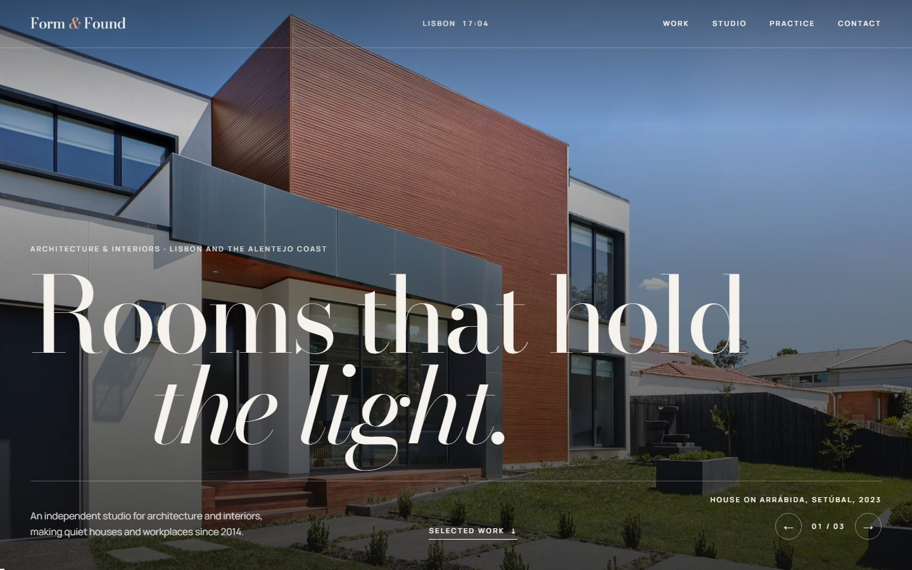

# Form & Found

A premium, art-directed landing page for **Form & Found**, a fictional independent
architecture and interior design studio working in Lisbon and on the Alentejo coast.

> Live demo: [form-and-found-iota.vercel.app](https://form-and-found-iota.vercel.app) · Part of [my portfolio](https://ilia-rusia.vercel.app)



## What's on the page

- Minimal navigation with a **live Lisbon studio clock**, and a full-screen mobile menu
- An opening curtain, then a full-bleed hero with very large Bodoni type and a **crossfading image carousel**
  (progress bar, pause on hover, previous/next controls, no autoplay with reduced motion)
- Studio introduction with a clip-path image reveal
- **Selected projects**: an asymmetric arrangement of three plates, then a full project index
  where a **preview image follows the cursor** (pointer devices only)
- **Project overlay** built on the native `<dialog>` element. `?project=casa-varela`
  opens it directly, so projects can be shared by link.
- "How we work" section with studio facts
- **Services accordion** animated with the CSS `grid-template-rows` technique
- **Pinned horizontal gallery** driven by the scroll position, with a progress line
- Dark **philosophy** section with three principles
- **Enquiry form** with validation and an honest success state (it's a concept site, so
  nothing is sent)
- Refined footer with an oversized wordmark

## Motion & accessibility

- One shared `IntersectionObserver` drives every scroll reveal (`src/hooks/useReveal.js`).
- All animation is disabled under `prefers-reduced-motion`.
- The cursor preview is moved with `requestAnimationFrame` and direct style updates instead
  of React state, so it stays smooth.
- Semantic landmarks, labelled controls, `aria-expanded` on the accordion and menu, a skip
  link and visible focus styles.

## Built with

React 19 · Vite · plain CSS with **native scroll-driven animations** (`animation-timeline: scroll()` / `view()`) ·
Bodoni Moda + Manrope · architectural photography from Unsplash

## Scroll-driven motion (no JavaScript animation)

- The hero photo zooms and the title floats away as you scroll, tied directly to the scroll position.
- Text rises and images unclip and parallax as they enter the viewport.
- The "In focus" gallery pins while the strip of photos slides sideways. JavaScript only measures
  how far it has to travel.
- Browsers without scroll timelines fall back to an IntersectionObserver reveal and a swipeable row.

## Run locally

```bash
npm install
npm run dev        # http://localhost:5177
```

## Build & deploy

```bash
npm run build      # outputs to dist/
npm run preview
```

Import the repository on [Vercel](https://vercel.com). It's a single page, so no extra
configuration is needed.

---

Form & Found is fictional. Projects, people and addresses were invented for this portfolio piece.
